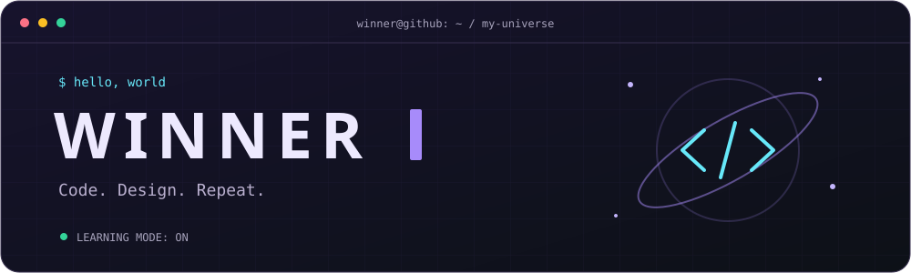
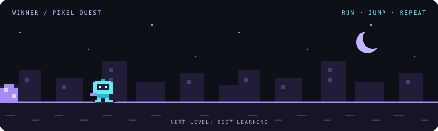

**Mahasiswa Teknik Informatika · Indonesia**

Coding, desain, anime, dan ide yang belum selesai digambar.

[About me](#-choose-your-route) · [Toolkit](#-inventory) · [GitHub stats](#-activity-board)

---

### 🕹️ Choose your route

 
🎮 A little pixel adventure — run, jump, keep learning.

Klik panel di bawah buat kenalan lebih jauh.

<b>01 · Main quest — belajar & membangun</b>

Halo, aku **Winner**! Aku sedang mendalami **Python** dan **JavaScript**, sambil belajar menghubungkan logika pemrograman dengan desain yang nyaman digunakan.

**Fokus belajarku:**

- 🐍 Memperkuat dasar pemrograman dengan Python.
- ⚡ Mengeksplorasi JavaScript dan interaksi antarmuka.
- 🎨 Merancang UI yang bersih dan intuitif di Figma.

<b>02 · Design lab — dari ide ke antarmuka</b>

Aku tertarik pada proses mengubah ide menjadi sesuatu yang bisa dilihat dan dicoba.

| Eksplorasi | Yang aku pelajari |
| :--- | :--- |
| Struktur | Wireframe & alur pengguna |
| Tampilan | Desain antarmuka & design system |
| Interaksi | Prototyping & komponen interaktif |
| Figma | Auto Layout & kolaborasi |

<b>03 · Side quests — di luar editor</b>

- 🎌 **Anime** — tempat mencari cerita dan inspirasi baru.
- ✏️ **Menggambar** — dari sketsa sampai digital art.
- 💭 **Rasa penasaran** — alasan buat terus mencoba.

> Belum harus jago untuk mulai. Mulai dulu, lalu naik level pelan-pelan.

### 🧰 Inventory

 

Tools yang menemani proses belajarku.

### 📡 Activity board

<b>Buka statistik GitHub ↗</b>

 

Kartu dimuat dari layanan eksternal. Kalau sedang tidak tersedia, lihat <a href="https://github.com/winner09-kun?tab=overview">aktivitas langsung di GitHub</a>.

---

**Thanks for visiting my little corner of GitHub.**

🌱 Learning in progress. Come back for the next chapter.

